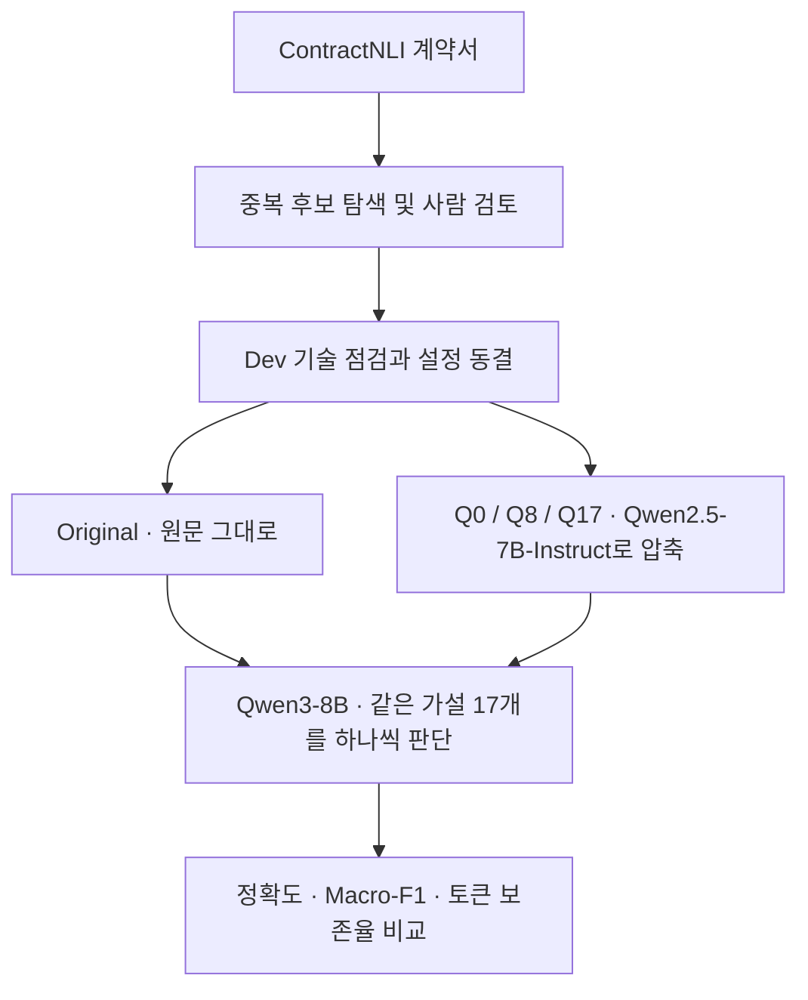

# 질문을 활용한 계약서 문맥 압축

**계약서를 압축하기 전에 판단할 질문을 알려 주면, 판단에 필요한 정보를 더 잘 남길 수 있을까?** ContractNLI의 계약서 119개와 고정 가설 17개를 사용해, 압축기에 보여주는 가설 수에 따라 판단 정확도가 어떻게 달라지는지 비교했다.

[연구 질문별 결과 보고서](docs/RESEARCH_QUESTION_RESULTS.md) · [결과 파일과 그림](results/README.md) · [실험 설계](design/EXPERIMENT_DESIGN.md) · [재현 명령](docs/REPRODUCIBILITY.md)

## 주요 결과

원문을 그대로 판단한 **Original의 정확도는 63.72%**였다. 아래는 같은 2,023문항을 압축 문맥으로 판단한 결과다.

| 압축 방법 | Q0 · 질문 없음 | Q8 · 질문 8개 | Q17 · 질문 17개 |
|---|---:|---:|---:|
| Naive · 일반 생성형 | 61.05% | 62.09% | **63.67%** |
| Contextualized · 보존 우선 생성형 | 61.34% | 61.10% | 60.80% |
| 추출형·일반 | 61.84% | 58.63% | 60.41% |
| 추출형·보존 우선 | 62.14% | 59.52% | 59.96% |

- Naive는 가설 17개를 미리 봤을 때 질문 없는 조건보다 **2.62%p** 더 정확했다. Q8에서는 Q0 대비 미리 본 가설에서 32문항을 더 맞혔고, 빠진 가설에서는 11문항을 덜 맞혔다. [연구 질문별 해석](docs/RESEARCH_QUESTION_RESULTS.md)
- 두 추출형은 질문을 제공할 때 남기는 토큰과 정확도가 함께 줄었다. 성능 차이는 각 압축 방법이 자연스럽게 만든 길이에서 관찰한 결과다. [보존율과 해석](docs/RESEARCH_QUESTION_RESULTS.md#압축-길이를-함께-봐야-하는-이유)

## 연구 진행 단계

| 단계 | 연구 질문 | 상태와 자료 |
|---|---|---|
| Main · 기준선 | 질문 없이 압축했을 때 원문으로 판단한 결과와 얼마나 다른가? | 완료 · [Main 결과](results/main/report.md) |
| Analysis 1 · 질문 제공 | 질문을 모두 또는 일부 알려 주면 같은 문항의 정답률이 어떻게 달라지는가? | 완료 · [Q17 결과](results/questions17/report.md) · [Q8 결과](results/questions8/report.md) |
| Analysis 2 · Lost in the Middle | 실제 모델 입력에서 근거가 놓인 위치에 따라 판단 성능이 달라지는가? | 예정 · [입력 위치 분석](design/EXPERIMENT_DESIGN.md#analysis-2) |
| Analysis 3 · Gold Evidence | 원문에서 판단에 필요한 근거가 압축 뒤에도 남아 있는가? | 예정 · [근거 보존과 오류 분석](design/EXPERIMENT_DESIGN.md#analysis-3) |

## 실험 파이프라인

생성형은 요약문을 쓰고, 추출형은 원문 단위를 골라 원래 순서로 연결한다. 두 방식에서 각각 일반 지시와 보존 우선 지시를 비교한다. 모델은 4bit NF4·greedy로 실행하고, 사용한 설정과 출력·실패를 기록한다. [공통 설정과 평가 기준](design/EXPERIMENT_DESIGN.md)

## 저장소 안내

| 위치 | 확인할 내용 |
|---|---|
| [docs/](docs/) | 연구 질문별 보고서, 재현 절차, 구현 규칙, 의사결정 |
| [design/](design/) | 실험 설계와 Analysis 2·3의 연구 계획 |
| [results/](results/) | 완료한 실험의 표·그림·공개 결과 파일 |
| [contract_experiment/](contract_experiment/) · [run_experiment.py](run_experiment.py) | 데이터 감사·전처리, Dev, 공통 프롬프트와 평가 |
| [memory_support/](memory_support/) · [run_memory_safe.py](run_memory_safe.py) | 전체 문맥을 유지하는 Main Test 실행 |
| [run_question_analysis.py](run_question_analysis.py) · [run_question_subset.py](run_question_subset.py) | Analysis 1의 Q17·Q8 실행 |
| [tests/](tests/) | CPU와 합성 데이터로 확인하는 실행 규칙 |

Python 3.11과 Windows PowerShell 기준 명령은 [재현 가이드](docs/REPRODUCIBILITY.md)에 있다. [구현 명세](docs/IMPLEMENTATION.md) · [의사결정 기록](docs/DECISIONS.md) · [변경 이력](CHANGELOG.md)
