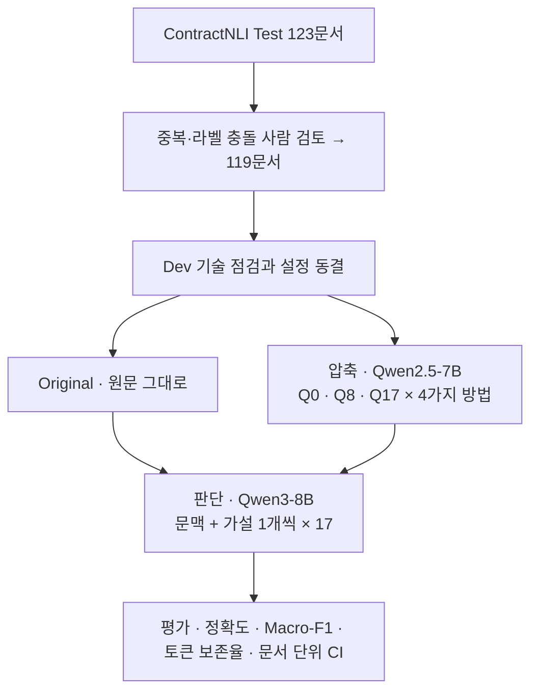

# 질문 정보를 활용한 계약서 문맥 압축

**계약서를 압축하기 전에 판단할 가설을 알려 주면, 판단에 필요한 정보가 압축 뒤에도 더 잘 남을까?**

ContractNLI 계약서 119개 × 가설 17개(2,023문항)를 Qwen2.5-7B-Instruct로 압축하고, Qwen3-8B가 압축 문맥만 읽고 판단한다. 압축 전에 보여 주는 가설 수만 0개(Q0)·8개(Q8)·17개(Q17)로 바꾸고, 나머지 조건은 모두 고정한다.

NLP Term Project · Team 4

## 주요 결과

원문을 그대로 판단한 **Original의 정확도는 63.72%**다. 아래는 같은 2,023문항을 압축 문맥으로 판단한 정확도다.

| 압축 방법 | 메인 · Q0 | 메인 · Q17 | 분석 1 · Q8 |
|---|---:|---:|---:|
| Naive · 생성형 일반 | 61.05% | **63.67%** | 62.09% |
| Contextualized · 생성형 보존 우선 | 61.34% | 60.80% | 61.10% |
| 추출형 · 일반 | 61.84% | 60.41% | 58.63% |
| 추출형 · 보존 우선 | 62.14% | 59.96% | 59.52% |

- **질문 없이 압축하면 원문보다 1.6~2.7%p 낮았다.** 압축 과정에서 판단 정보가 손실된다.
- **가설 17개를 보여 주자 Naive만 2.62%p 올라 원문 수준이 됐다** (95% CI +0.59~+4.75%p). 추출형은 남기는 분량과 정확도가 함께 줄었다. [메인 실험](docs/02_main_q0_vs_q17.md)
- **가설 8개만 보여 주면 이득이 보여 준 가설에 집중됐다.** Naive는 보여 준 가설에서 Q0보다 32문항 더 맞혔고, 빠진 가설에서는 Q17보다 35문항 덜 맞혔다. [분석 1](docs/03_analysis1_q8.md)
- 성능은 각 방법이 자연스럽게 만든 길이에서 측정했다. 길이·출력 형식의 영향이 포함된다. [한계](docs/06_limitations.md)

## 연구 구성

| 단계 | 질문 | 상태 | 담당 | 문서 |
|---|---|---|---|---|
| 메인 실험 | 가설 17개를 모두 보여 주면(Q17) 보여 주지 않을 때(Q0)보다 정확해지는가? | 완료 | (확인 필요) | [02_main_q0_vs_q17](docs/02_main_q0_vs_q17.md) |
| 분석 1 | 가설 8개만 보여 주면(Q8) 보여 준 가설과 빠진 가설에서 각각 어떻게 달라지는가? | 완료 | 정재환 | [03_analysis1_q8](docs/03_analysis1_q8.md) |
| 분석 2 | 근거가 입력의 앞·중간·뒤 어디에 있느냐가 판단에 영향을 주는가? | 예정 | (확인 필요) | [04_analysis2_position](docs/04_analysis2_position.md) |
| 분석 3 | 판단이 바뀐 문항에서 원문의 근거는 압축 후에도 남아 있었는가? | 예정 | (확인 필요) | [05_analysis3_evidence](docs/05_analysis3_evidence.md) |

## 실험 파이프라인



압축 방법은 **생성형**(요약문 작성)과 **추출형**(원문 문장·조항 선택) × **일반 지시**와 **보존 우선 지시**(의무 주체·조건·예외·부정 우선)의 2×2다. 두 모델 모두 4bit NF4·greedy로 실행했다. [실험 설계](docs/01_design.md)

## 문서

| 문서 | 내용 |
|---|---|
| [01 · 실험 설계](docs/01_design.md) | 데이터 정제, 압축 조건, 질문 제공 조건, 판단·평가 |
| [02 · 메인 실험](docs/02_main_q0_vs_q17.md) | Q0 vs Q17 결과, 라벨·가설별 변화, 출력 형식, 비용 |
| [03 · 분석 1](docs/03_analysis1_q8.md) | Q8 제공·미제공 묶음별 결과, 가설별 일관성 |
| [04 · 분석 2](docs/04_analysis2_position.md) | 근거 위치 분석 계획 |
| [05 · 분석 3](docs/05_analysis3_evidence.md) | Gold Evidence 대조 계획 |
| [06 · 한계](docs/06_limitations.md) | 길이·형식·통계·일반화의 한계 |
| [재현 가이드](docs/reproducibility.md) | 환경 설정과 실행 명령, 팀 분석용 파일 |
| [구현 명세](docs/implementation.md) | 파싱·실패 처리·통계 등 구현 규칙 |
| [개발 기록](docs/dev-log/README.md) | 설계 결정, 변경 이력, 실행 이력 |

## 저장소 구조

```
├── docs/                       # 보고서 순서의 문서 (01~06), 재현·구현 문서, dev-log/
├── results/                    # 공개 결과 (CSV·JSONL은 실행 원본 그대로)
│   ├── main/                   #   메인 실험: original/ · q0/ · q17/ · analysis/(그림·요약)
│   ├── analysis1_q8/           #   분석 1
│   ├── analysis2_position/     #   분석 2 (예정)
│   ├── analysis3_evidence/     #   분석 3 (예정)
│   ├── dataset.json            #   공통 원문·가설·정답·Gold Evidence
│   └── manifest.json           #   파일별 SHA256과 원본 실행 경로
├── contract_experiment/  run_experiment.py        # 데이터 감사·전처리, Dev, 공통 프롬프트·평가
├── memory_support/       run_memory_safe.py       # 메인: Original·Q0 실행 (긴 입력 메모리 정책)
├── question_support/     run_question_analysis.py # 메인: Q17 실행과 Q17−Q0 비교
├── question_subset/      run_question_subset.py   # 분석 1: Q8 배정·실행과 Q0·Q17 비교
└── tests/                                         # CPU·합성 데이터 테스트
```

코드 폴더와 실행 파일의 이름·위치는 실행 기록의 소스 해시 검증에 쓰이므로 바꾸지 않는다. Python 3.11과 Windows PowerShell 기준 명령은 [재현 가이드](docs/reproducibility.md)에 있다.

## 데이터 출처

계약서 원문과 근거 주석은 Koreeda & Manning의 [ContractNLI](https://stanfordnlp.github.io/contract-nli/)([논문](https://aclanthology.org/2021.findings-emnlp.164/), [CC BY 4.0](https://creativecommons.org/licenses/by/4.0/))이다.
