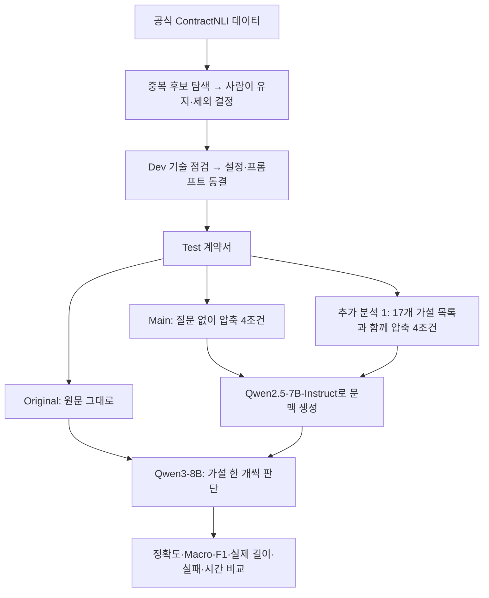

# ContractNLI 문맥 압축과 계약 판단

계약서를 압축했을 때 LLM의 판단 정확도가 얼마나 유지되는지 비교하는 Python 3.11 프로젝트다. 질문 없이 압축하는 Main과, 같은 압축 방법에 고정 17개 가설 목록을 함께 제공하는 추가 분석 1을 진행했다.

| 문서 | 확인할 내용 |
|---|---|
| [현재까지의 실험 결과](docs/RESULTS.md) | Main·질문 제공 실험의 성능, 실제 보존율, 출력 문제와 해석 |
| [재현 및 터미널 실행 명령](docs/REPRODUCIBILITY.md) | 환경 준비, 전처리, Dev, Main Test, 질문 제공, 중단 후 재개 |
| [전체 실험 설계](design/EXPERIMENT_DESIGN.md) | 비교 목적, 변인 통제, 평가와 후속 분석의 범위 |

## 전체 파이프라인

1. **데이터 준비:** 공식 Train/Dev/Test를 검증하고, 텍스트 유사도로 중복 후보를 찾는다. 사람이 원문·라벨·근거를 보고 한 문서 유지, 양쪽 제외, 별개 문서 유지를 결정한다. 코드는 그 결정을 적용하고 최종 문서 수를 계산한다.
2. **Dev 점검:** 모델을 학습하지 않는 zero-shot 평가다. Train은 데이터 감사에만 사용하고, Dev는 입력·출력 형식과 실행 설정 점검에 사용한다. Dev 정확도를 높이는 방향으로 규칙을 고르지 않는다.
3. **Main 평가:** 규칙을 동결한 후 Original을 먼저 판단하고, 같은 Test 계약서를 질문 없이 네 방법으로 압축해 평가한다.
4. **질문 제공 비교:** 같은 계약서에 17개 가설 목록을 한꺼번에 제공한다. 문서·방법별 압축문 하나를 17개 판단에 재사용하고, Original과 질문 없는 비교 결과는 완료한 Main에서 재사용한다.
5. **결과 분석:** 동일한 문서·가설·Gold로 성능과 실제 보존율을 비교한다. 같은 계약서의 17문항을 묶는 문서 단위 부트스트랩으로 불확실성을 계산하고 실패 기록도 분모에 유지한다.

## 비교 조건

Original을 기준선으로 두고, 압축 4조건을 출력 방식과 보존 지시의 2×2로 구성한다.

| 출력 방식 | 일반 지시 | 보존 우선 지시 |
|---|---|---|
| 생성형: 축약 본문 작성 | Naive | Contextualized |
| 추출형: 원문 단위 선택 | 추출형·일반 | 추출형·보존 우선 |

보존 우선 조건에는 의무 주체, 조건·예외, 부정·금지, 논리 연결과 진술 범위를 우선하라는 문장 하나를 더한다. 추출형은 선택한 문장·조항을 통째로 원문 순서대로 연결한다. 실제 출력이 의도한 형식을 지켰는지는 결과와 별도로 기록한다.

## 공통 설정과 평가 원칙

- **압축·선택:** Qwen2.5-7B-Instruct. **판단:** Qwen3-8B, thinking off. 두 모델에 NF4 4bit·bfloat16을 적용하고 greedy로 생성한다.
- **질문 정보:** Main 압축에는 넣지 않는다. 추가 분석 1에서는 압축 user 입력에 고정 17개 가설과 공통 안내를 넣는다. 판단 입력은 항상 문맥과 가설 한 개다. Gold Label·Gold Evidence는 어느 압축에도 제공하지 않는다.
- **길이:** 프롬프트에 목표 보존율·길이 지시를 넣지 않고 최소 생성 길이도 강제하지 않는다. 공통 안전 상한은 유지하며, 실제 판단 문맥의 Qwen3 토큰 수로 보존율을 측정한다. 방법 간 길이가 같다고 가정하지 않는다.
- **실행·기록:** Main Test와 질문 제공 실험에 같은 전체 문맥 OOM 보완 정책을 적용한다. 모델 리비전·환경·프롬프트·소스 해시, 원본 출력·종료·실패를 저장하고 중단 후 같은 설정으로 재개한다.

Main과 추가 분석 1은 완료했다. 코드로 길이를 제약하는 추가 분석 2와 Gold Evidence 기반 오류 분석 3은 이후 진행할 범위다. 현재 결과는 자연 출력 길이에서의 비교이며, 질문 제공에 따른 출력 방식 변화도 [결과 문서](docs/RESULTS.md)에 함께 정리했다.

## 코드와 기록

| 위치 | 역할 |
|---|---|
| `contract_experiment/`, `run_experiment.py` | 데이터 감사·전처리·Dev·공통 모델 및 평가 |
| `memory_support/`, `run_memory_safe.py` | 전체 문맥을 유지하는 메모리 보완 Main Test |
| `question_support/`, `run_question_analysis.py` | 고정 17가설 제공과 Main 대비 추가 분석 |
| `tests/` | CPU·합성 데이터 기반 최소 검증 |

프롬프트는 [Main](contract_experiment/prompts.py)과 [질문 제공 블록](question_support/prompts.py), 고정 모델 버전은 [모델 리비전](docs/model_revisions.json)에서 확인한다. 실행 당시 전문과 실제 설정은 각 run에 보관한다.

변경 이유는 [의사결정 기록](docs/DECISIONS.md), 수정 내역은 [CHANGELOG](CHANGELOG.md), 구현·검증 범위는 [구현 문서](docs/IMPLEMENTATION.md)에 남긴다. 기존 발표자료와의 차이는 [설계 비교](design/DESIGN_COMPARISON.md), 이전 오류 복구 과정은 [과거 실행 기록](docs/archive/EXECUTION_HISTORY.md)을 참고한다.
