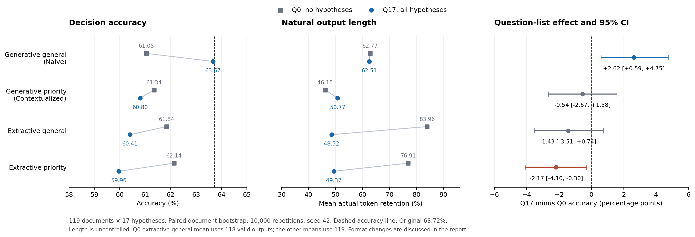

# 공개 실험 결과

[프로젝트 개요](../README.md) · [연구 질문별 결과 보고서](../docs/RESEARCH_QUESTION_RESULTS.md) · [재현 명령](../docs/REPRODUCIBILITY.md)

메인 실험 **Q0 대 Q17**과 후속 **Analysis 1의 Q8** 결과다. 모든 압축 조건은 ContractNLI Test **119문서·2,023문항**을 공유한다. Q0, Q17, Q8은 압축기에 미리 보여준 가설 수를 뜻한다.

세 실행에 공통으로 사용한 원문과 Gold Evidence는 [공통 `dataset.json`](dataset.json)에 있다. 실제 압축문은 아래 실행별 `contexts.jsonl`의 `text`에 있다. [팀 분석에서 파일을 연결하는 방법](../docs/REPRODUCIBILITY.md#team-data)

## 메인 실험 · 질문 유무 비교

원문을 그대로 판단한 Original을 기준선으로 두고, 같은 네 압축 방법에서 Q17과 Q0의 차이를 계산했다.

| 실행 | 보고서와 집계 | 문맥과 문항별 기록 |
|---|---|---|
| Original·Q0 | [원문 기준선](main/baseline/report.md) · [Q0 결과](main/report.md) · [성능](main/metrics.csv) · [Original 대비](main/comparisons.csv) | [문맥 JSONL](main/contexts.jsonl) · [판단 JSONL](main/predictions.jsonl) · [예측 CSV](main/predictions.csv) · [기술 진단](main/diagnostics/technical_summary.json) |
| Q17 | [Q17 결과](questions17/report.md) · [메인 비교 Q17−Q0](questions17/question_effects.csv) · [성능](questions17/metrics.csv) | [문맥 JSONL](questions17/contexts.jsonl) · [판단 JSONL](questions17/predictions.jsonl) · [예측 CSV](questions17/predictions.csv) · [기술 진단](questions17/diagnostics/technical_summary.json) |

`question_effects.csv`는 **Q17−Q0**, `comparisons.csv`는 **Original−압축 조건**을 보고한다. CSV의 0.30은 30%를 뜻한다. 실패 문항은 정확도와 Macro-F1의 분모에 포함한다.

### Q0과 Q17 비교 그림

회색은 Q0, 파랑은 Q17이다. 정확도 그래프의 점선은 Original **63.72%**다. 성능은 각 방법이 자연스럽게 만든 문맥 길이에서 측정했다.

- [질문 제공 효과 상세 분석](analysis/QUESTION_EFFECTS.md)
- [그림 PNG](analysis/comparison.png) · [그림 PDF](analysis/comparison.pdf)
- [문서별 변화](analysis/document_effects.json) · [가설별 변화](analysis/hypothesis_effects.json)
- [출력 형식 점검](analysis/format_audit_summary.json)

### 길이·판단·실행 기록

| 항목 | Original·Q0 | Q17 |
|---|---|---|
| 문서별 길이·보존율 | [길이](main/lengths.csv) | [길이](questions17/lengths.csv) |
| 혼동행렬 | [혼동행렬](main/confusion_matrices.csv) | [혼동행렬](questions17/confusion_matrices.csv) |
| 시간 | [실행 시간](main/times.csv) | [질문 제공 실행 시간](questions17/question_times.csv) |
| 집계 설정·정의 | [Q0 분석 설정](main/analysis.json) | [Q17 분석 설정](questions17/question_analysis.json) |
| 라벨별 성능 | [클래스 Recall](main/metrics.csv) | [라벨별 변화](questions17/question_label_effects.csv) |

Q0와 Q17의 공개 예측은 각각 10,115건이다. Q17의 예측표에는 앞서 실행한 Original의 2,023건이 함께 들어 있다.

## Analysis 1 · 질문 8개 제공

Q8을 메인 실험의 Q0·Q17과 같은 문항에서 비교한다. 새 판단 기록은 네 압축 방법에서 8,092건이다. [Q8 전체 및 제공 여부별 집계](questions8/report.md)

- [실제 압축문](questions8/contexts.jsonl) · [판단 JSONL](questions8/predictions.jsonl) · [세 조건의 문항별 비교 CSV](questions8/paired_predictions.csv)
- [방법별 성능·신뢰구간](questions8/subset_effects.csv) · [가설별 변화](questions8/subset_hypothesis_effects.csv) · [보존율·시간·실패](questions8/subset_resources.csv)
- [문서별 가설 배정](questions8/assignment.json) · [집계 설정](questions8/subset_analysis.json) · [기술 진단](questions8/diagnostics/technical_summary.json)

## 출처와 후속 분석

각 파일의 로컬 실행 경로, 원본과 공개본의 SHA256, 공개용 편집 내역은 manifest에 기록했다. JSONL은 저장소 전체를 내려받아 실행 폴더별로 읽을 수 있다. [결과 manifest](manifest.json) · [팀 분석에 필요한 파일](../docs/REPRODUCIBILITY.md#team-data)

계약서 원문과 근거 주석의 출처는 Hitachi America, Ltd.의 **ContractNLI**다. 공개 스냅샷은 Koreeda와 Manning의 공식 Test에서 중복·라벨 불일치 문서 네 개를 제외하고 실험용 원문 단위를 추가한 버전이다. 원문과 근거의 문자 위치를 유지했다. 문맥 파일에는 이 원문과 실험 모델이 생성하거나 선택한 압축문이 들어 있다. [ContractNLI 논문](https://aclanthology.org/2021.findings-emnlp.164/) · [공식 데이터 출처](https://stanfordnlp.github.io/contract-nli/) · [데이터 라이선스 CC BY 4.0](https://creativecommons.org/licenses/by/4.0/)

입력 내 근거 위치를 살피는 [Analysis 2](../design/EXPERIMENT_DESIGN.md#analysis-2)와 압축 후 근거를 대조하는 [Analysis 3](../design/EXPERIMENT_DESIGN.md#analysis-3)은 예정 단계다.
